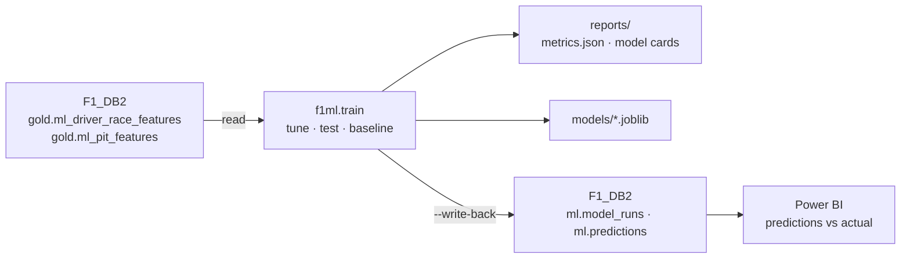

# F1 Analytics ML

Machine-learning models trained on the **[F1 Data Warehouse](https://github.com/Sahil-Patel180/SQL_Projects/tree/main/F1%20Data%20Warehouse)** (SQL Server, bronze → silver → gold). The models read the warehouse's leakage-safe feature views, are tested on later seasons than they learned from, are compared against simple baselines, and write their predictions back into the warehouse for Power BI.



## Models

| Task | Predicts | Type | Baseline it must beat |
| --- | --- | --- | --- |
| `podium` | Probability a starter finishes top 3 | binary classifier | "Top 3 on the grid finish on the podium" |
| `finish_position` | Finishing order of the field | regressor, ranked per race | "Finish where you started" |
| `dnf` | Probability a starter does not finish | binary classifier | The team's DNF rate over its last 10 races |
| `positions_gained` | Grid minus finish, classified starters | regressor | "Nobody gains or loses places" |
| `pit_stop_class` | 0-1, 2 or 3+ pit stops (2010+) | multiclass classifier | Last year's average at the same circuit |
| `pit_stop_ms` | Average pit-lane time per stop (2010+) | regressor | The team's average over its last 5 races |

All models are scikit-learn `HistGradientBoosting`, which handles missing values natively (e.g. no qualifying time, a driver's first race at a circuit).

## How it avoids fooling itself

- **No leakage.** Features come only from the `gold.ml_*` views, where every rolling value ends at the driver's *previous* race. The warehouse's gold quality checks recompute one feature from scratch to prove it, and `tests/test_leakage.py` blocks ids and `target_*` columns from ever being features.
- **Split by season, never at random.** Train 2010–2021, choose hyper-parameters on 2022, report on 2023–2024 once. A random split would put drivers of the same race on both sides.
- **Always against a baseline.** Every metric is shown next to a simple rule a fan would use. A model that does not beat its baseline is reported as such, not hidden.
- **Walk-forward backtest.** `f1ml.backtest` retrains for every season from 2016 and scores it, which shows whether accuracy survives regulation changes (2017, 2022).

## Run it (Windows, PowerShell)

Prerequisites: the F1 Data Warehouse loaded in SQL Server (database `F1_DB2`), Python 3.10+, and **ODBC Driver 17 or 18 for SQL Server**.

```powershell
git clone https://github.com/Sahil-Patel180/f1-analytics-ml.git
cd f1-analytics-ml
python -m venv .venv
.venv\Scripts\Activate.ps1
pip install -e ".[dev]"

copy .env.example .env      # set SQL_SERVER, e.g. SAHIL\SQLEXPRESS
pytest -q                   # unit tests, no database needed
```

Then:

```powershell
python -m f1ml.data export                     # optional: cache the feature views to data/*.csv
python -m f1ml.train                           # train + evaluate all 6 models (reads SQL Server)
python -m f1ml.train --source csv              # same, from the CSV cache
python -m f1ml.backtest --first 2016 --last 2024
python -m f1ml.train --write-back              # also fill ml.model_runs and ml.predictions
```

Outputs:

| Path | Contents |
| --- | --- |
| `reports/metrics.json` | Test-season metrics, baseline metrics, chosen parameters, top features, per task |
| `reports/model_cards/<task>.md` | One readable card per model |
| `reports/backtest.csv` | Season-by-season model vs baseline |
| `models/<task>.joblib` | Production model trained on every completed season |

Check the write-back in SSMS:

```sql
USE F1_DB2;
SELECT model_name, model_version, train_from_season, train_to_season,
       test_from_season, test_to_season, created_at
FROM ml.model_runs ORDER BY run_id DESC;

-- 2024 podium probabilities vs what happened
SELECT r.race_label, d.full_name, p.probability, f.finish_position
FROM ml.predictions p
JOIN ml.model_runs m        ON m.run_id = p.run_id AND m.model_name = 'podium' AND m.model_version = 'eval'
JOIN gold.dim_race r        ON r.race_id = p.race_id
JOIN gold.dim_driver d      ON d.driver_id = p.driver_id
JOIN gold.fact_results f    ON f.race_id = p.race_id AND f.driver_id = p.driver_id AND f.session_type = 'Race'
WHERE r.season_year = 2024
ORDER BY r.round, p.probability DESC;
```

Each `--write-back` adds two runs per model: `eval` (trained to 2022, predictions for the test seasons) and `prod` (trained on every completed season, predictions for the current season's completed races).

## Project layout

```
f1-analytics-ml/
├── src/f1ml/
│   ├── config.py      settings from .env
│   ├── db.py          SQL Server connection (SQLAlchemy + pyodbc)
│   ├── data.py        load / export the gold.ml_* views
│   ├── tasks.py       the 6 tasks: target, features, model, baseline, scoring
│   ├── splits.py      season splits and walk-forward
│   ├── metrics.py     AUC, PR-AUC, Brier, top-3 hit rate, per-race Spearman, MAE, F1
│   ├── train.py       tune → test → production fit → reports → write-back
│   ├── backtest.py    walk-forward evaluation
│   └── writeback.py   ml.model_runs / ml.predictions inserts
├── tests/             leakage, split and metric tests (run in CI)
└── reports/           generated metrics and model cards
```

## Limits

- Predictions exist only for races already in the warehouse. A race with no result row yet has no grid or qualifying in the feature view, so upcoming races are not scored.
- Pit-stop strategy depends heavily on safety cars and weather, which are not features yet (planned: FastF1 / Meteostat enrichment for 2018+).
- Global feature importance is permutation-based; per-prediction explanations (SHAP) are not included.

## Related

- Warehouse: [SQL_Projects / F1 Data Warehouse](https://github.com/Sahil-Patel180/SQL_Projects/tree/main/F1%20Data%20Warehouse)
- Next in this repo: local LLM race narratives (Ollama) written to `ml.narratives`.
